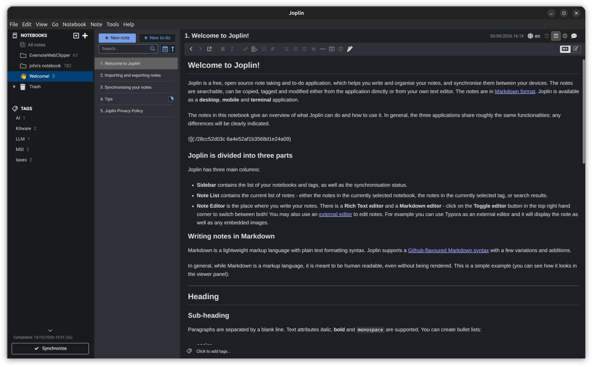

# Joplin Lite

## Overview

Joplin-Lite is a desktop application that implements the core functionaliy of the Joplin Desktop application in a much smaller memory footprint. 

## Goals

The primary objective is to use Joplin notes with a much smaller disk and memory footprint than the Joplin Desktop app, which is built on the Electron platform. Although Electron is impressive, bundling an entire chrome browser into 1 app is a dreadful waste of resources, mainly memory but also CPU resources for unused browser features.

## Core Features

- UI is a 3-column layout similar to the Joplin Desktop (screenshot below). First column a list (or preferably, tree display) of folders. Second column a list of note titles (or possibly title plus snippet?) for the selected folder. Third column the selected note with selectable display, possibly tabs, for markdown and rendered format.
- Access to all notes for viewing and editing
- Creation of notes
- A note search capability
- Synchronization with S3 cloud storage.

## Technical Stack

- pywebview to start the Joplin Data/API server as a subprocess. Python will be used to invoke S3 synchronization.
- Vue.js/Vite to provide the UI
- The original plan was to access the joplin server (data api) directly from javascript, but because of CORS constraints, access will be relayed through the Python back end.
- The Python backend might also be used for other utility operations (synchronization might be one).

## Deferred or Out of Scope Features

- The initial work will be for developer-based install on linux systems. There might be future interest in a macos version, but no specific plans to deploy an installer on github or pypi.
- Other cloud storage options (dropbox, Joplin cloud) are not supported.
- The Joplin ToDo feature will not be supported
- Joplin note tags will not be supported, at least not in the initial version.
- wysiwyg editing is not required for the initial version.

## Joplin Desktop - Example Screenshot

